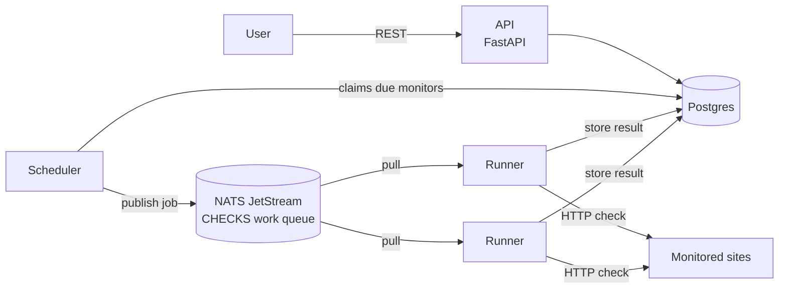
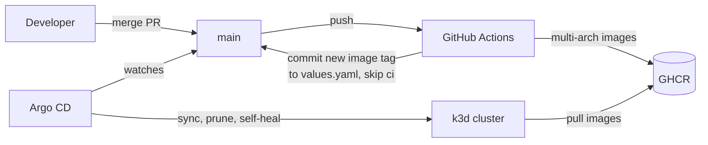

# Pulse

A synthetic monitoring platform: define what to watch, and Pulse checks it on a schedule, records
status and response time, and reports uptime and p95 latency.



| Service | Responsibility |
|---|---|
| `api` | Monitor CRUD, check history, 24h uptime and p95 latency (computed in SQL). Owns the schema. |
| `scheduler` | Every second, claims due monitors (`FOR UPDATE SKIP LOCKED`) and publishes one job per check. |
| `runner` | Pulls jobs, runs the HTTP check, stores the result, then acks. Scale it horizontally. |
| `browser-runner` | Runs browser monitors in headless Chromium (Playwright); keeps a screenshot when a step fails. |
| `notifier` | Sends a Telegram message when an incident opens and when it is resolved. |
| `web` | The dashboard, monitor pages and public status page (nginx); forwards `/api` to the API. |

### Design choices

- **Work queue between scheduling and execution.** Runners can be added or removed without the
  scheduler noticing, and a job a runner did not finish is redelivered.
- **Ack after the write.** A runner that crashes mid-check loses nothing: the job comes back.
- **`SKIP LOCKED` claims.** Several schedulers can run at once without scheduling a check twice.
- **Metrics everywhere.** Every service exposes Prometheus metrics: the API on `/metrics`, the
  scheduler and runners on `:9100` (`pulse_jobs_scheduled_total`, `pulse_checks_total`,
  `pulse_check_latency_seconds`).

## Run locally

```bash
docker compose up --build -d
curl -X POST localhost:8800/api/monitors -H 'Content-Type: application/json' \
  -d '{"name": "Example", "url": "https://example.com", "interval_seconds": 10}'
curl localhost:8800/api/monitors
```

API docs: http://localhost:8800/docs · NATS monitoring: http://localhost:8222

## Run on Kubernetes (local k3d cluster)

A 3-node cluster (1 server, 2 agents) on Docker. It adds a `k3d-pulse` kube context without
switching away from the current one.

```bash
k3d cluster create --config deploy/k3d/cluster.yaml
helm --kube-context k3d-pulse upgrade --install pulse deploy/helm/pulse -n pulse --create-namespace --wait
curl localhost:8880/healthz
```

The chart (`deploy/helm/pulse`) runs the API (2 replicas behind a Traefik ingress), the scheduler,
the runners (spread over nodes, with a PodDisruptionBudget), Postgres and NATS JetStream as
StatefulSets with persistent volumes. Pulse pods run as non-root with a read-only root filesystem and
no Linux capabilities. The API is ready only when the database answers, but its liveness probe only
checks that the process listens, so a database outage does not cause restart loops. The scheduler
and runners stop gracefully on SIGTERM.

To try local code before CI has built it, build `:dev` images and import them:

```bash
for s in api scheduler runner browser-runner notifier web; do docker build -t ghcr.io/hananva2-blip/pulse-$s:dev services/$s; done
k3d image import -c pulse ghcr.io/hananva2-blip/pulse-{api,scheduler,runner,browser-runner,notifier,web}:dev
helm --kube-context k3d-pulse upgrade --install pulse deploy/helm/pulse -n pulse --set image.tag=dev --wait
```

## GitOps with Argo CD

The cluster runs what `main` says. Nobody runs `helm upgrade` or `kubectl apply` against the app.



```bash
./deploy/argocd/bootstrap.sh   # installs Argo CD, applies the root app, prints the admin password
```

- **App of Apps:** `deploy/argocd/root.yaml` is the only manifest applied by hand. It creates every
  Application in `deploy/argocd/apps/`.
- **Automatic tag updates:** after CI pushes images from `main`, its `deploy` job rewrites the one
  `image.tag` line in `values.yaml` and commits it with `[skip ci]`. Argo CD rolls the new images out.
  A change that touches only `deploy/` builds no images, so it redeploys nothing but what it changed.
- **Self-heal:** a manual `kubectl scale` or a deleted Service is reverted within seconds.
- **No permanent diffs:** the StatefulSets' `volumeClaimTemplates` state the fields the API server
  would default; only the runtime `status` is ignored.

Argo CD UI: http://argocd.localhost:8880 (user `admin`).

## Observability

Metrics, logs and traces, all deployed by Argo CD from `deploy/argocd/apps/` with values in
`deploy/monitoring/`.

| Pillar | Stack | What Pulse sends |
|---|---|---|
| Metrics | Prometheus (kube-prometheus-stack) | ServiceMonitors for the API (`/metrics`), scheduler and runners (`:9100`): checks by result, check latency, jobs scheduled, API requests and latency |
| Logs | Loki, collected by Grafana Alloy | Every pod's output; runner and scheduler lines end in `trace_id=<id>` |
| Traces | Tempo, over OpenTelemetry (OTLP) | One trace per check: `schedule check` (scheduler) → `run check` (runner) → the HTTP check and the result insert |

**A trace crosses the queue.** The scheduler injects the trace context into the NATS message
headers; the runner extracts it and continues the same trace:

```
- [pulse-scheduler] schedule check      1ms
  - [pulse-runner]  run check           7ms  ERROR
    - [pulse-runner] GET                6ms  ERROR
    - [pulse-runner] INSERT             1ms
```

In Grafana, a `trace_id` in a log line links to its trace in Tempo, and a trace links back to its
logs. The **Pulse** dashboard (`deploy/helm/pulse/dashboards/pulse.json`, provisioned from a
ConfigMap) shows checks, the scheduling pipeline, the API and the pods, with logs underneath.

**Alerts** (`PrometheusRule` in the chart): `PulseRunnersDown`, `PulseChecksStuck` (jobs scheduled but
none executed), `PulseSchedulerErrors`, `PulseApiErrors`.

| UI | URL |
|---|---|
| Grafana | http://grafana.localhost:8880 (`admin` / `pulse-dev`, local only) |
| Prometheus | http://prometheus.localhost:8880 |
| Alertmanager | http://alertmanager.localhost:8880 |

Tracing is on only where `OTEL_EXPORTER_OTLP_ENDPOINT` is set; the chart sets it from
`tracing.endpoint`. docker-compose and the tests run without it.

On macOS with Rancher Desktop, k3d's kubelets share one VM kernel and run out of inotify instances,
which breaks log collection ("too many open files"). Raise the limits in the VM:
`fs.inotify.max_user_instances=512`, `fs.inotify.max_user_watches=524288`.

## Autoscaling, canary releases and quality gates

**KEDA scales the runners on the queue backlog.** A `ScaledObject` watches how many jobs wait in
the `http-runners` NATS consumer and targets 20 waiting jobs per runner, between 2 and 8 replicas.
With 300 monitors pointed at a slow endpoint, the runners went from 2 to 8 in about 30 seconds,
and back to 2 about a minute after the queue drained. The runner Deployment leaves `replicas` out
when KEDA owns it, otherwise Argo CD self-heal would undo every scale-up.

The load test also found two runner bugs, now fixed and covered by tests: jobs of deleted monitors
were redelivered forever (they are now dropped, and any job is terminated after 5 failed deliveries),
and a timeout from the NATS client crashed runners under load.

**Argo Rollouts releases the API as a canary.** A new version gets half the pods, waits 30 seconds,
then an `AnalysisTemplate` reads the 5xx rate of the canary pods only from Prometheus:

| Release | Canary error rate | Outcome |
|---|---|---|
| Faulty (`api.faultInjectionRate=0.5`) | 51.6% | Aborted automatically; the stable version kept serving |
| Healthy | 0%, 0%, 0%, 0% | Promoted to all pods |

`FAULT_INJECTION_RATE` is a deliberate chaos switch for this demo; it is registered before the
Prometheus middleware so the injected 500s are counted. The canary is on with
`api.canary.enabled=true` (it needs Argo Rollouts in the cluster).

**Every PR runs quality gates** (`quality-gates` job in CI): the PR's images are built and loaded into
a throwaway kind cluster, the chart is installed, Playwright end-to-end tests (`e2e/`) drive the whole
pipeline (API → scheduler → NATS → runner → Postgres) against an in-cluster test server, and a k6
load test (`load/api-smoke.js`) fails the PR if p95 latency or the error rate cross their thresholds.
The results are posted as a comment on the PR.

```bash
pip install -r requirements-e2e.txt
PULSE_URL=http://localhost:8880 TEST_TARGET=http://pulse-httpbin.pulse pytest e2e
docker run --rm -i -e PULSE_URL=http://host.docker.internal:8880 grafana/k6:1.3.0 run - < load/api-smoke.js
```

## Incidents and Telegram alerts

An incident opens when a monitor fails `failures_to_alert` checks in a row (default 2, so a single
blip stays quiet), and the next good check resolves it. `GET /api/incidents?status=open` lists them.

- **The decision is a Postgres trigger on `checks`.** It runs in the same transaction as the check
  insert, so both runners get it without sharing code, and a unique partial index allows only one
  open incident per monitor.
- **The incidents table is the outbox.** The notifier polls for incidents whose message was not
  sent yet, sends it, then marks it. A failed send is retried on the next poll; a crash between
  sending and marking can send a message twice, never zero times.
- **Without a token the notifier only logs the messages**, so CI and kind need no secrets.

To get the messages on Telegram, create a bot with [@BotFather](https://t.me/BotFather), send it a
message, find your chat id in `https://api.telegram.org/bot<token>/getUpdates`, then:

```bash
kubectl -n pulse create secret generic pulse-telegram \
  --from-literal=bot-token=<token> --from-literal=chat-id=<chat id>
kubectl -n pulse rollout restart deployment pulse-notifier
```

The token lives only in that Secret, never in Git. The notifier never logs it: httpx request logs are
off, and send errors are logged by type and status code only, since their text contains the URL.

## Dashboard and status page

`http://localhost:8880` on the k3d cluster (`http://localhost:8801` with docker compose):

- **Monitors** (`/`): every monitor with its status, 24h uptime and p95, the open incidents, and a
  form to add HTTP or browser monitors.
- **Monitor** (`/monitor?id=…`): its incidents and recent checks, with the screenshot of each failed
  browser check.
- **Status page** (`/status`): the public view. A service shows as down only while it has an open
  incident, so one failed check does not turn it red. URLs stay hidden.

Plain HTML and JavaScript modules, no build step, served by unprivileged nginx with a read-only root
filesystem. nginx also proxies `/api`, so the pages call the API on their own origin and need no CORS.
Everything a user typed is added to the page as text, never as HTML, and a Content-Security-Policy
allows scripts from the site itself only.

## AWS (Terraform, free tier)

`infra/aws` describes a home for Pulse on AWS that stays inside the free tier. CI checks it on every
change (`fmt`, `validate`, `tflint`, and a Trivy misconfiguration gate) but never applies it: there
are no AWS credentials in CI.

| Resource | Why |
|---|---|
| One `t3.micro`, Ubuntu 24.04, single-node K3s | The free tier covers one micro instance all month. EKS is not free ($0.10/hour for the control plane). |
| VPC with one public subnet and an internet gateway | No NAT gateway, which would cost about $32 a month |
| Security group: ports 80 and 443 only | No SSH and no Kubernetes API from outside. A shell and port forwarding go through AWS Systems Manager. |
| IAM role with `AmazonSSMManagedInstanceCore` only | The node can talk to SSM and nothing else |
| gp3 disk, encrypted, 20 GB | The EBS free tier is 30 GB |
| `cpu_credits = "standard"` | The t3 default, `unlimited`, bills CPU bursts; `standard` never costs extra |
| IMDSv2 only, hop limit 1 | Pods cannot read the instance's credentials |
| `ignore_changes = [ami]` | A new Ubuntu image does not replace the running node (a SkyWatch lesson) |
| AWS Budgets: an email at 50% of $1 actual or 100% forecast | Any spend means something left the free tier |

Variables are validated: only `t3.micro` or `t2.micro`, and a disk of 8–30 GB. Trivy's one open
finding is MEDIUM: there are no VPC Flow Logs, which would cost CloudWatch storage.

```bash
cd infra/aws
cp terraform.tfvars.example terraform.tfvars   # set budget_email
terraform init && terraform plan
terraform apply                                 # only after checking the account's free tier
$(terraform output -raw kubernetes_api_tunnel)  # in another terminal: the K3s API on localhost:6443
helm upgrade --install pulse ../../deploy/helm/pulse -n pulse --create-namespace \
  -f ../../deploy/helm/pulse/values-aws.yaml --set postgres.password="$PULSE_DB_PASSWORD"
terraform destroy
```

`values-aws.yaml` keeps only the core pipeline: no Argo Rollouts, KEDA, Prometheus stack or
browser runner. The chart refuses to render without `postgres.password`, so the password is never
committed.

**Not verified yet.** No `apply` has run, because the AWS account is not activated. The memory budget is the
risk: the pods request 480 Mi next to K3s on 1 GB plus 2 GB swap. In SkyWatch, a K3s v1.35 build ran
out of memory on a t3.micro.

## Test

Tests run against a real Postgres, in a separate `pulse_test` database.

```bash
docker compose up -d postgres
pip install -r requirements-dev.txt
ruff check .
pytest
```

## Roadmap

1. ~~Services, queue and tests in docker-compose~~
2. ~~CI: lint, tests, Trivy-gated multi-arch images on GHCR~~
3. ~~Local Kubernetes (k3d) and the Helm chart~~
4. ~~Argo CD GitOps with automatic image tag updates~~
5. ~~Prometheus, Grafana, Loki, Tempo: metrics, logs, traces across the queue, alerts, dashboard~~
6. ~~KEDA autoscaling, Argo Rollouts canary with automatic rollback, quality gates on every PR~~
7. ~~Playwright browser checks~~, ~~incidents and Telegram alerts~~, ~~dashboard and status page~~,
   ~~Terraform for AWS (code and CI checks)~~, domain and HTTPS
