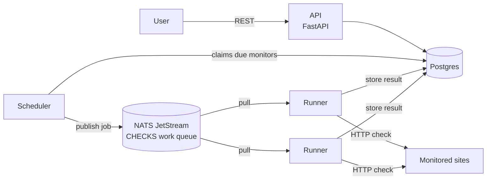

# Pulse

A synthetic monitoring platform: define what to watch, and Pulse checks it on a schedule, records
status and response time, and reports uptime and p95 latency.



| Service | Responsibility |
|---|---|
| `api` | Monitor CRUD, check history, 24h uptime and p95 latency (computed in SQL). Owns the schema. |
| `scheduler` | Every second, claims due monitors (`FOR UPDATE SKIP LOCKED`) and publishes one job per check. |
| `runner` | Pulls jobs, runs the HTTP check, stores the result, then acks. Scale it horizontally. |

### Design choices

- **Work queue between scheduling and execution.** Runners can be added or removed without the
  scheduler noticing, and a job a runner did not finish is redelivered.
- **Ack after the write.** A runner that crashes mid-check loses nothing: the job comes back.
- **`SKIP LOCKED` claims.** Several schedulers can run at once without scheduling a check twice.
- **Metrics everywhere.** Every service exposes Prometheus metrics: the API on `/metrics`, the
  scheduler and runners on `:9100` (`pulse_jobs_scheduled_total`, `pulse_checks_total`,
  `pulse_check_latency_seconds`).

## Run locally

```bash
docker compose up --build -d
curl -X POST localhost:8800/api/monitors -H 'Content-Type: application/json' \
  -d '{"name": "Example", "url": "https://example.com", "interval_seconds": 10}'
curl localhost:8800/api/monitors
```

API docs: http://localhost:8800/docs · NATS monitoring: http://localhost:8222

## Test

Tests run against a real Postgres, in a separate `pulse_test` database.

```bash
docker compose up -d postgres
pip install -r requirements-dev.txt
ruff check .
pytest
```

## Roadmap

1. ~~Services, queue and tests in docker-compose~~
2. CI in GitHub Actions
3. Terraform (AWS), Ansible, K3s
4. Helm and ArgoCD
5. Prometheus, Grafana, Loki, Tempo
6. KEDA autoscaling, Argo Rollouts canary, quality gates on every PR
7. Playwright browser checks, alerts, dashboard, domain and HTTPS
